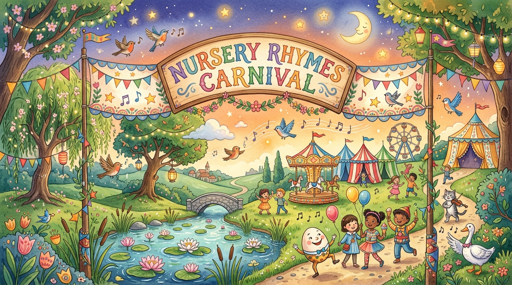

# Chorar Mela (ছড়ার মেলা) 🎠📚

A delightful, educational Android application designed for children to explore and enjoy classic and beloved Bengali Nursery Rhymes (বাংলা ছোটদের ছড়া ও কবিতা).

## ✨ Features

- **Classic Bengali Rhyme Collection (জনপ্রিয় বাংলা ছড়া সংগ্রহ):**
  - *হাট্টিমা টিম টিম* (Hattima Tim Tim by Rokonuzzaman Khan)
  - *আমাদের ছোট নদী* (Amader Chhoto Nodi by Rabindranath Tagore)
  - *ভোর হলো দোর খোলো* (Bhor Holo Dor Kholo by Kazi Nazrul Islam)
  - *খোকা ঘুমাল পাড়া জুড়াল* (Traditional Folk Lullaby)
  - *চাঁদ উঠেছে ফুল ফুটেছে* (Chand Utheche Phul Phuteche)
  - *আতা গাছে তোতা পাখি* (Aata Gache Tota Pakhi)
  - *বাবুরাম সাপুড়ে* (Baburam Sapure by Sukumar Ray)
  - *কাঠবেড়ালী কাঠবেড়ালী* (Kathberali Kathberali by Kazi Nazrul Islam)
  - *নোটন নোটন পায়রাগুলি* (Noton Noton Pairaguli)
  - *খোকা যাবে মাছ ধরতে* (Khoka Jabe Machh Dhorte)
  - *তাই তাই তাই* (Tai Tai Tai)
  - *বাক বাকুম পায়রা* (Bak Bakum Paira)
  - *আমপাতা জোড়া জোড়া* (Aam Pata Jora Jora)
  - *বৃষ্টি পড়ে টাপুর টুপুর* (Brishti Pore Tapur Tupur by Rabindranath Tagore)
  - *আয় রে আয় টিয়ে* (Aay Re Aay Tiye)

- **Interactive Audio Recital & Melody (ছড়া আবৃত্তি ও মিষ্টি সুর):**
  - Line-by-line Bengali speech synthesis with real-time karaoke highlight.
  - Interactive tap-to-read: tap any line to hear that individual line spoken.
  - Soothing background music box chime synthesizer to accompany recitals.
  - Adjustable playback speed (0.8x for young learners, 1.0x normal, 1.2x fast) and repeat mode.

- **Bilingual & Learning Support (উচ্চারণ ও ভাবার্থ):**
  - Authentic Bengali script.
  - English phonetic transliteration for diaspora and non-native learners.
  - Meaning, context, and fun cultural trivia for every rhyme.
  - Dynamic font size scaling (A / A+ / A++).

- **Favorites & Search (অনুসন্ধান ও পছন্দের তালিকা):**
  - Instant search across Bangla titles, authors, and lyrics.
  - Category filters: All, Popular, Animals, Bedtime, Great Poets, Playful.
  - Save favorite rhymes for bedtime listening.

- **Interactive Rhyme Quiz & Game (ছড়ার খেলা ও কুইজ):**
  - Fill-in-the-blank trivia game testing beloved lines.
  - Cheerful instant feedback with score tracking and high-score records.

## 🛠️ Architecture & Tech Stack

- **Platform:** Android (Min SDK 24, Target SDK 36)
- **Language:** Kotlin
- **UI Toolkit:** Jetpack Compose (Material 3)
- **Audio:** Android TextToSpeech (`Locale.forLanguageTag("bn-BD")` / `bn-IN`) + Synthesized `AudioTrack` PCM tone generator
- **State & Persistence:** ViewModel, StateFlow, SharedPreferences
- **Build System:** Gradle (Kotlin DSL) with Version Catalogs
